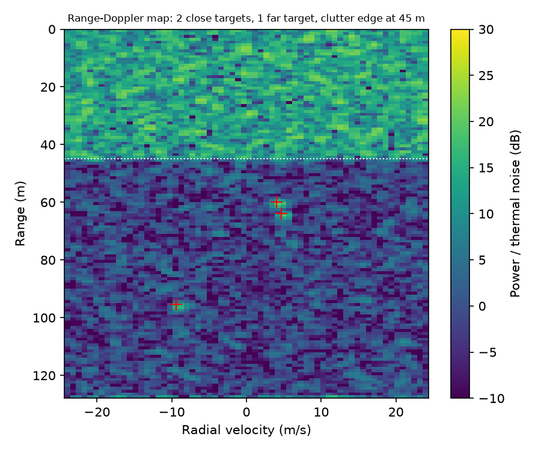
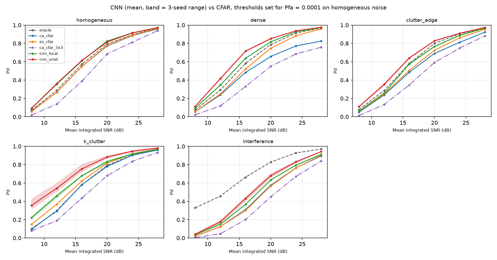
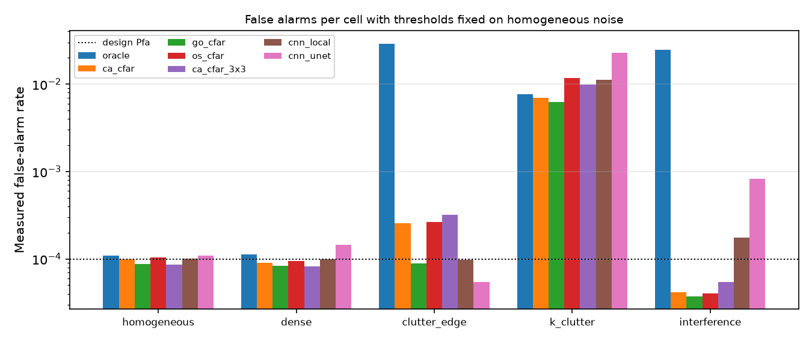

# NeuralRadar

> I measured the reference results using the original benchmark environment.

**FMCW radar target detection: CFAR detectors checked against theory, then a small
CNN compared with them at the same false-alarm rate**

I started with a simulator and classical baseline that I checked against theory.
I used the classical benchmark frames to score the neural networks as well.

1. **Baseline:** an FMCW range-Doppler simulator and four classical detectors. I
   checked noise scaling, peak gain, false-alarm rates and detection curves against
   closed-form theory before trusting any result.
2. **Classical benchmark:** CA-, GO- and OS-CFAR (plus a known-noise reference) in
   five scenarios, two of which the networks never see in training.
3. **Learned detection:** a small U-Net (118,625 parameters) and a 4-layer local CNN
   (7,265 parameters), three seeds each, calibrated to the same false-alarm rate as
   CFAR and compared on identical targets with paired bootstrap intervals.

```text
targets + noise/clutter/interference -> beat signal (128 samples x 64 chirps)
  -> Hann window -> 2-D FFT -> |.|^2 range-Doppler map (noise mean = 1 per cell)
  -> CFAR: cell power / noise estimate from a 248-cell ring  ---+
  -> CNN: dB map (median removed) -> logit map                --+-> threshold set on
                                                                    target-free frames
                                                                    for Pfa = 1e-4
```

**CFAR** (constant false-alarm rate) means estimating the noise level around each
cell from its neighbours, so the threshold follows the local noise. **Pd** is the
probability of detecting a target. **Pfa** is the fraction of noise-only cells that
cross the threshold.

## Setup

I use Python 3.12 and [uv](https://docs.astral.sh/uv/). `uv.lock` pins every package.
Run everything from the project folder:

```powershell
uv sync --locked --extra neural
uv run pytest -q --basetemp=.pytest-tmp
uv run ruff check .
uv run ruff format --check .
```

PyTorch is only needed for stage 3. The lock file points at the CUDA 12.8 build of
torch 2.9.1; it also runs on a CPU. I trained on an RTX 3050 Laptop GPU (4 GB).

All data is simulated from fixed seeds. `configs/detection/protocol.json` holds every
setting: scenarios, seeds, SNR grid, training mixture and network settings.

`run_study.bat` runs the whole study (tests, all stages and the figures).

## The radar model

| Parameter | Value |
| --- | --- |
| Carrier, sweep bandwidth | 77 GHz, 150 MHz |
| Range bins | 128 x 1.0 m (0 to 128 m) |
| Doppler bins | 64 chirps at 40 us: 0.76 m/s per bin, +/- 24.3 m/s |
| Window | Hann in both axes |
| Targets | Swerling 1 (power redrawn every frame), random fractional range and Doppler |
| SNR | mean integrated SNR after the 2-D FFT (per-sample SNR + 39.1 dB) |

Targets sit at fractional bin positions, so most of them straddle two cells. That
loss is part of every result here.

## Stage 1: checking the baseline

```powershell
uv run python scripts/verify_baseline.py
```

Results: [results/baseline](results/baseline).

| Check | Measured | Expected |
| --- | --- | --- |
| Mean noise power per cell, no window / Hann | 0.9986 / 1.0008 | 1 |
| Noiseless target peak at the right cell, no window / Hann | 20.00 dB / 16.48 dB | 20.00 dB / 16.48 dB |
| Known-noise detector Pfa, Hann, design 1e-4 | 9.71e-5 | 1e-4 |
| CA-CFAR Pfa with the theory threshold, no window, design 1e-4 | 1.02e-4 | 1e-4 |
| CA-CFAR Pfa with the theory threshold, Hann, design 1e-4 | 1.46e-4 | 1e-4 |
| SNR for Pd = 0.9, steady target, on-bin, no window | 11.82 dB | 11.80 dB |
| SNR for Pd = 0.9, Swerling 1, on-bin, no window | 19.86 dB | 19.39 dB |

The simulator matches theory where theory applies. The Hann window makes
neighbouring cells correlated, so the textbook CA-CFAR threshold gives 46 percent
more false alarms than designed. That is why I set every threshold in the later
stages empirically, on 600 target-free frames, at Pfa = 1e-4. With the Hann window
and off-bin targets, Pd = 0.9 needs 16.29 dB for a steady target (4.5 dB more) and
23.73 dB for a Swerling 1 target (3.9 dB more).

## Stage 2: classical benchmark

```powershell
uv run python scripts/run_classical_benchmark.py
```

Results: [results/classical_benchmark](results/classical_benchmark).

Detectors (all CFAR windows use 2 guard cells and a 248-cell training ring):

- **oracle:** divides by the true thermal noise level. Not possible in a real radar,
  but a useful reference in white noise.
- **ca_cfar:** mean of the ring. **go_cfar:** the larger of the two range halves.
  **os_cfar:** the 75th percentile of the ring.
- **ca_cfar_3x3:** CA-CFAR on the map after summing each 3 x 3 block. I added this
  after stage 3 to test whether the CNN wins simply by adding up energy from
  neighbouring cells. It does not (see below).

Scenarios, 1,500 test frames each (250 at each SNR from 8 to 28 dB):

| Scenario | What changes | In CNN training? |
| --- | --- | --- |
| homogeneous | 1 to 4 targets in white noise | yes |
| dense | 6 to 10 targets, 60 percent placed 3 to 6 bins from another target | yes |
| clutter_edge | noise 15 dB higher below a random range edge (30 to 90 m), targets beyond it | yes |
| k_clutter | spiky clutter: random gamma(0.5) power per range bin | no |
| interference | 4 chirps hit by 25 dB bursts from another radar | no |

A target counts as detected if the highest score in its 3 x 3 neighbourhood crosses
the threshold. Noise cells are cells more than 2 bins from every target.



## Stage 3: CNN detectors

```powershell
uv run python scripts/train_detector.py
uv run python scripts/evaluate_detector.py
uv run python scripts/diagnose_neighbour_gain.py
```

Results: [results/neural_detection](results/neural_detection).

- **Input:** the map in dB minus the frame median, divided by 10. **Output:** one
  logit per cell.
- **Padding:** circular in Doppler (the Doppler axis wraps around), replicate in range.
- **Training data:** 12,000 frames (45,003 targets) from the homogeneous, dense and
  clutter_edge scenarios, SNR 6 to 30 dB, 10 percent target-free. The seeds differ
  from the test and calibration seeds.
- **Labels:** 1 on each target's cell. Cells within 2 bins of a target are left out
  of the loss, because the window spreads target energy there.
- **Training:** weighted cross-entropy, AdamW, cosine learning rate, 15 epochs, batch
  32, best validation-loss epoch kept. Seeds 11, 22 and 33.
- **Time:** one U-Net seed took 7 to 9 minutes; one local CNN seed took under 3 minutes.

Each network gets its own threshold from the same 600 target-free frames as CFAR,
for Pfa = 1e-4.



### Results in the training scenarios

SNR needed for Pd = 0.5 and 0.8 at the calibrated thresholds. CNN rows are 3-seed
means. I show the measured Pfa because a detector can buy Pd with extra false alarms.

| Scenario | Detector | Measured Pfa | SNR for Pd 0.5 | SNR for Pd 0.8 |
| --- | --- | --- | --- | --- |
| homogeneous | oracle | 1.10e-4 | 14.97 dB | 20.27 dB |
| homogeneous | CA-CFAR | 0.99e-4 | 15.32 dB | 21.00 dB |
| homogeneous | OS-CFAR | 1.05e-4 | 15.30 dB | 20.84 dB |
| homogeneous | CA-CFAR 3x3 | 0.87e-4 | 17.51 dB | 23.61 dB |
| homogeneous | local CNN | 1.02e-4 | 14.27 dB | 19.53 dB |
| homogeneous | U-Net | 1.10e-4 | 14.19 dB | 19.70 dB |
| dense | CA-CFAR | 0.90e-4 | 16.37 dB | 26.08 dB |
| dense | OS-CFAR | 0.94e-4 | 15.68 dB | 21.55 dB |
| dense | local CNN | 1.00e-4 | 14.10 dB | 19.61 dB |
| dense | U-Net | 1.46e-4 | 13.10 dB | 18.44 dB |
| clutter_edge | CA-CFAR | 2.57e-4 | 16.31 dB | 23.62 dB |
| clutter_edge | GO-CFAR | 0.89e-4 | 16.72 dB | 24.61 dB |
| clutter_edge | OS-CFAR | 2.66e-4 | 15.91 dB | 22.22 dB |
| clutter_edge | local CNN | 0.99e-4 | 15.06 dB | 21.09 dB |
| clutter_edge | U-Net | 0.55e-4 | 14.04 dB | 19.39 dB |

Paired difference in Pd, CNN minus CFAR, on the same targets, with each detector's
threshold set for Pfa = 1e-4 inside that scenario, so false alarms are equal. Each
value is the 3-seed mean. For every seed, the 95 percent frame-bootstrap interval was
above zero.

| Scenario | U-Net vs CA | U-Net vs OS | local vs CA | local vs OS |
| --- | --- | --- | --- | --- |
| homogeneous | +4.5 points | +4.4 | +4.7 | +4.6 |
| dense | +15.2 | +8.9 | +12.4 | +6.1 |
| clutter_edge | +14.6 | +12.6 | +8.2 | +6.2 |

What I take from this:

- In white noise both CNNs need about 1.1 dB less SNR than CA-CFAR for Pd = 0.5.
  The 7k-parameter local CNN is as good as the U-Net here.
- Close targets hurt CA-CFAR most, because a neighbouring target inside the ring
  raises its noise estimate (target masking). In the dense scenario CA-CFAR needs
  26 dB for Pd = 0.8 and GO-CFAR never reaches it. OS-CFAR copes better, as theory
  says. The CNNs gain most here.
- At the clutter edge, CA- and OS-CFAR give 2.6 times the designed false alarms,
  because cells just below the edge see quiet cells in their ring. GO-CFAR holds the
  false-alarm rate but loses Pd. The U-Net kept false alarms at about half the
  design value and still had the best Pd. Its larger view (about 44 x 44 cells)
  lets it see where the edge is.
- The U-Net does not hold the calibrated rate perfectly: in the dense scenario it
  gives 1.46e-4 instead of 1e-4. The matched-Pfa comparison removes that advantage,
  and it still wins by 8.9 points over OS-CFAR.

### Why does the CNN beat the known-noise detector?

In white noise the CNNs detect about 3 points more targets than the oracle at the
same Pfa, although the oracle knows the exact noise level. The oracle compares one
cell to a threshold, so it is not the best possible detector for an off-bin target
whose energy forms a known shape over several cells. I tested two simple
explanations on separate diagnostic frames (seed 9001) with one U-Net seed.

| Detector, Pfa = 1e-4 | Pd at 12 dB | Pd at 16 dB | Pd at 20 dB | false-alarm clusters / cells |
| --- | --- | --- | --- | --- |
| known noise, one cell | 0.277 | 0.564 | 0.791 | 190 / 207 |
| known noise, peaks only | 0.285 | 0.568 | 0.796 | 207 / 207 |
| known noise, 2 x 2 sum | 0.234 | 0.507 | 0.756 | 155 / 207 |
| known noise, 3 x 3 sum | 0.170 | 0.430 | 0.716 | 111 / 207 |
| U-Net (seed 11) | 0.343 | 0.620 | 0.826 | 165 / 207 |

- **Summing neighbouring cells** makes detection worse. The Hann main lobe keeps
  most of the energy in one or two cells, so the sum adds more noise than signal.
- **Counting false alarms per cell** is not the reason either. At Pfa = 1e-4 almost
  every noise crossing is a single cell, and keeping only local peaks changes Pd by
  less than one point. The U-Net's false alarms are more clustered than the
  oracle's, so counting per false object would favour it further.

So the gain is real under my scoring rule, but I have not pinned down the
mechanism. My guess is that the network has learned the 2-D shape of a straddled
Hann main lobe and weighs neighbouring cells better than a box sum. A shape-matched
classical filter is the next thing I would test.

### Out-of-distribution scenarios: where the CNN loses

| Scenario | Detector | Measured Pfa (design 1e-4) | SNR for Pd 0.5 | Pd at matched Pfa 1e-4 |
| --- | --- | --- | --- | --- |
| k_clutter | CA-CFAR | 7.0e-3 | 14.88 dB | 0.372 |
| k_clutter | GO-CFAR | 6.3e-3 | 15.89 dB | 0.337 |
| k_clutter | OS-CFAR | 1.18e-2 | 14.07 dB | 0.357 |
| k_clutter | local CNN | 1.11e-2 | 12.73 dB | 0.421 |
| k_clutter | U-Net | 2.30e-2 | 11.05 dB | 0.449 |
| interference | CA-CFAR | 4.2e-5 | 18.86 dB | 0.469 |
| interference | OS-CFAR | 4.1e-5 | 18.99 dB | 0.467 |
| interference | local CNN | 1.75e-4 | 17.99 dB | 0.470 |
| interference | U-Net | 8.26e-4 | 17.11 dB | 0.481 |

- **Spiky clutter breaks every detector.** With thresholds set on white noise, all
  of them give 60 to 230 times the designed false-alarm rate. The U-Net is the
  worst: 2.3e-2, 3.3 times CA-CFAR (2.1e-2 to 2.5e-2 over seeds). Its lower "SNR for
  Pd 0.5" here comes from those extra false alarms, not from real sensitivity. At
  matched Pfa it still detects 7.7 points more than CA-CFAR, so it ranks targets
  better, but its threshold no longer means what it was calibrated to mean.
- **Interference is a clear loss for the CNN.** The bursts raise the CFAR noise
  estimates, so CFAR becomes more cautious (4e-5) and loses about 3.5 dB of
  sensitivity. The U-Net instead fires on the interference streaks: 8.3 times the
  designed false-alarm rate (3.7e-4 to 1.44e-3 over seeds). At matched Pfa its gain
  over CA-CFAR shrinks to +1.2 points (2 of 3 seeds significant), and the local CNN
  is level with CFAR (+0.15 points, no seed significant).
- In a real radar, a false-alarm rate that drifts with the scene is a serious
  problem. CFAR keeps the meaning of its threshold by construction. The CNNs keep it
  only in conditions they were trained on.



## Limitations and next steps

- Everything is simulated, with one target model (Swerling 1 point targets) and
  one frame at a time. Real data would add extended targets, multipath and clutter
  with Doppler spread.
- The validation loss was still falling slowly at epoch 15 (best epoch 15 in 4 of 6
  runs), so longer training might help a little. I did not tune hyperparameters
  beyond one set.
- I would add interference and spiky clutter to training, then test on a third
  unseen condition, to see whether the false-alarm drift is a data problem or a
  model problem.
- A shape-matched classical detector (a weighted kernel for the straddled Hann
  lobe) is the fair next baseline for the white-noise result.
